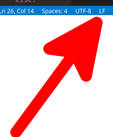

# Plutonium Scripting

Scripts are written in python. Many accessor methods are provided to scripts in order to control the bot.

## Windows

On Windows you'll have to make sure that your line endings are LF and not CRLF. You can do this with [Visual Studio Code](https://code.visualstudio.com/) by going to the bar at the bottom and switching CRLF to LF. Example:



## Script layout

The basis of scripting is the `loop` function. You will want to define a function like this:

```python
def loop():
    return 5000
```

Whatever you return from `loop` will be the wait time in milliseconds before `loop` gets called again.

## Config

A `settings` object is available in the global scope which contains what was defined in the account toml file under the `[script.settings]` section.

For example with a config file like this:

```toml
[account]
user = "myuser"
pass = "mypass"
autologin = true
enabled = true
debug = true

[script]
name = "autofighter.py"

[script.settings]
fight_mode = 0
npc_ids = [29, 34]
```

The settings object would contain both `fight_mode` and `npc_ids`. They can be accessed like this inside a script:

```python
def loop():
    if get_combat_style() != settings.fight_mode:
        set_combat_style(settings.fight_mode)
        return 1000

    if in_combat():
        return 500

    if get_fatigue() >= 95:
        use_sleeping_bag()
        return 1000

    npc = get_nearest_npc_by_id(ids=settings.npc_ids, in_combat=False, reachable=True)
    if npc != None:
        attack_npc(npc)
        return 500
  
    return 500
```

Note the usage of the `settings` object.

## Progress reports

Within the `[script]` block of the `account.toml` file you are allowed to define a `progress_report` field with a duration. This duration is waited upon to call a function `on_progress_report` that should return a string dict. For example with a config like this:

```toml
[script]
name = "seers_yews.py"
progress_report = "20m"
```

It would call the `on_progress_report` function every 20 minutes, generating a report in `logs/progress_reports`. An `on_progress_report` function may look like this:

```python
def on_progress_report():
    return {"Woodcutting Level": get_max_stat(8), \
            "Logs Banked": logs_banked}
```

Which would generate a report like this:

```
+-------------------+-------+
|        KEY        | VALUE |
+-------------------+-------+
| Woodcutting Level |    81 |
| Logs Banked       |  6216 |
+-------------------+-------+
```

## API

Check out the API documentation [here](https://gitlab.com/open-runescape-classic/plutonium/-/blob/main/API.md).

## Limitations of gpython

There are many. Here I will document the limitations known about gpython.

#### Globals in submodules

You won't be able to access the settings object in submodules outside of functions. It's fine within functions.

#### List comprehensions

If you pass a variable to a function that uses that variable in a list comprehension you must make a local copy of the variable before using it. For example:

```python
def a(b):
    b0 = b
    return [x for x in range(10) if x > b0]
```

Without the line `b0 = b`, you will receive an error `NameError: "free variable 'b' referenced before assignment in enclosing scope"`.

#### Strings

There are only 3 functions attached to the `str` object. `startswith`, `endswith` and `split`.

#### Time

`time.time_ns()` is missing. Use `time.time()` instead.

#### Dicts

Dicts can only have string keys.

#### Map/Filter/Reduce

Map/filter/reduce aren't defined.